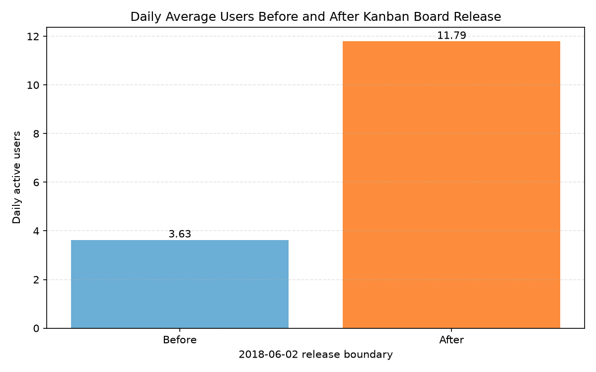
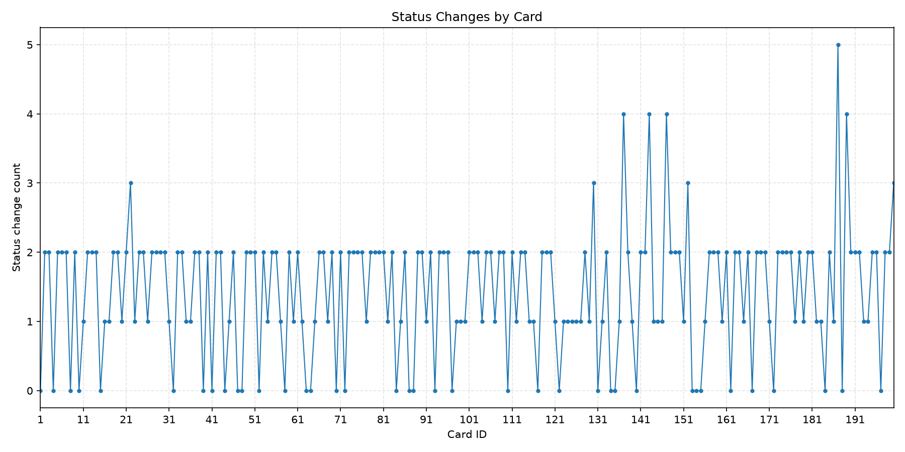

  
  

 
	<b><a href="#task">Task Overview</a></b>
	|
	<b><a href="#installation">Installation Instructions</a></b>
	| 
	<b><a href="https://www.insidesherpa.com/modules/oRMogWRHeewqHzA7u/nEg96uYWs9oh5Jrbc" target="_blank">Link to Module 3</a></b>		
	| 
	<b><a href="https://www.insidesherpa.com/virtual-internships/prototype/oRMogWRHeewqHzA7u/College%20Students%3A%20Learn%20how%20to%20work%20at%20a%20YC%20startup">Link to Y Combinator Program</a></b>

<h1> Introduction</h1> 
<b> College Students: Learn how to work at a Y Combinator startup </b>

Train online for the skills Y Combinator startups are looking for. One of the official ways to get recruited into a Y Combinator startup.

<h2 id="task"> Module 3 Task Overview </h2>

Analytics - Analyse the latest feature releases

 <b>Aim:</b>Create insights and ideas backed by data

Please clone this repository to start the task. Edit file <b>answer.sql</b> with your SQL query to produce meaningful data

On 2018-06-02, we released the Kanban Board on Shiptivity app. It has a major impact on our stats and we want to iterate on it

<b>Purpose</b>

We want to generate a few key ideas to move us on one of our core metrics: daily active users.

<b>Acceptance Criteria</b>
<ol>
<li>This task is complete when we have a graph created that maps out the daily average users before and after the feature change</li>
<li>This task is complete when we have a graph of the number of status changes by card</li>
<li>This task is complete when you upload the SQL queries that can generate this information</li>
<li>This task is complete when we have three actionable ideas stated in the format below:
<ol>
	<li>Hypothesis </li>
	<li>Expected Impact </li>
	<li>What the feature is (a quick explanation of the feature)</li>
</ol>
</li>
<li>Sketches and flows of these features are optional but helpful (wireframe quality is enough)</li>
</ol>

<h2 id="installation" >Installation</h2>

You will need to have <b>sqlite3</b> installed

If you do not have sqlite3 installed, follow this <a href="https://www.tutorialspoint.com/sqlite/sqlite_installation.htm">guide</a> on how to install sqlite3.

On your terminal, try running <code>sqlite3 ./shiptivity.db</code>.

You can start running SQL command on the terminal.

Tips: try <code>.schema</code> to see a list of CREATE TABLE commands for the db.

 If you want to go back to tthe original state of db, there is a <code>dump</code> called shiptivity.dump that you can run to restore the data to its unchanged state.

<h2 id="analytics">Analytics graphs</h2>

Generate the two acceptance-criteria graphs with Python:

<pre><code>python -m pip install matplotlib
python generate_charts.py</code></pre>

The charts are written to the <code>graphs/</code> directory:

<ul>
  <li><code>graphs/daily_average_users.png</code> — daily average users before and after the 2018-06-02 Kanban Board release</li>
  <li><code>graphs/status_changes_by_card.png</code> — status changes for cards 1–200</li>
</ul>

<h3>Daily average users</h3>

The average rose from 3.63 users per day before the release to 11.79 users per day after the release.

<h3>Status changes by card</h3>

All 200 cards have a status-change result, and 286 valid status transitions were recorded. Card 187 (Kutch-Mueller) had the most status changes, with 5.

<h2 id="ideas">Actionable ideas</h2>

<h3>1. Guided first Kanban move</h3>

<b>Hypothesis:</b> Users who see an immediate guided prompt to move their first card from backlog to in-progress will understand the Kanban workflow and return more often.

<b>Expected Impact:</b> Increase daily active users by 10–15% by turning one-time visitors into users with an initial completed workflow.

<b>Feature:</b> After creating or viewing a board, show a one-time guided tooltip pointing from a backlog card to the in-progress column. Include a short success confirmation after the first drag.

<h3>2. Inactive-user return notifications</h3>

<b>Hypothesis:</b> A targeted reminder will bring users back when a card they own or recently moved is updated or awaiting a status change.

<b>Expected Impact:</b> Increase the 7-day active-user rate and lift daily active users by 5–10% through re-engagement.

<b>Feature:</b> Add optional email or in-app notifications for card assignments, approaching due dates, and cards left unchanged for a configurable period.

<h3>3. Fast-status actions and bulk moves</h3>

<b>Hypothesis:</b> Reducing the number of interactions needed to update card status will encourage more frequent use of the Kanban board.

<b>Expected Impact:</b> Increase the status-change rate by 15–20%, because the data shows substantial movement after the Kanban feature was introduced.

<b>Feature:</b> Add right-click or keyboard status menus and allow users to select several cards and move them to the same status at once.

